# Proposta Architetturale & Piano di Sviluppo: Studio TTS Professionale per la Lingua Italiana
> **Documento di Specifica e Revisione Tecnica**  
> **Destinatari**: Product Owner (Utente) & Technical Reviewer (ChatGPT)  
> **Autore**: Antigravity (Lead AI Engineer & Architect)  
> **Data**: Novembre 2026

---

## 1. Visione e Obiettivi del Progetto

L'obiettivo è progettare e implementare un'applicazione software autonoma per la **generazione Text-to-Speech (TTS) e Voice Cloning ad altissima fedeltà per la lingua italiana**, con standard acustici e prosodici adatti a contesti professionali (audiolibri, doppiaggio, podcast, assistenti vocali).

Il punto di partenza concettuale è la repository open-source **`bc-dunia/qwen3-TTS-studio`** (interfaccia Gradio per la famiglia di modelli Alibaba Qwen3-TTS). L'intento non è replicare passivamente tale strumento, bensì:
1. **Risolvere i limiti strutturali** del progetto originale (chunking acustico cieco, assenza di normalizzazione linguistica, ricaricamento frequente dei modelli in memoria, post-processing assente).
2. **Integrare una pipeline linguistica e fonetica specializzata per l'italiano**.
3. **Fornire un percorso di Fine-Tuning (SFT / LoRA)** per creare voci italiane native da studio, superando i difetti del solo zero-shot in-context cloning.
4. **Ottimizzare le risorse hardware** per un'esecuzione fluida e addestramenti efficienti entro 12 GB di VRAM.

---

## 2. Profilo Hardware & Vincoli di Esecuzione

Lo sviluppo e l'esecuzione avverranno su due ambienti distinti:

| Parametro | Ambiente 1: Laptop da Sviluppo | Ambiente 2: Desktop Workstation |
| :--- | :--- | :--- |
| **GPU** | NVIDIA GeForce RTX 4080 Laptop (Ada Lovelace) | GPU NVIDIA dedicata (12 GB VRAM) |
| **VRAM** | 12 GB GDDR6 (Supporto BF16, FP8, FlashAttention-2) | 12 GB VRAM |
| **RAM di Sistema** | 32 GB DDR5 | > 100 GB RAM |
| **Ruolo Operativo** | Sviluppo, test rapido, inferenza, UI locale | Pre-processing massivo dataset, Fine-Tuning LoRA esteso |

### Strategia di allocazione risorse
* **Inferenza (12 GB VRAM)**: Il modello **Qwen3-TTS 1.7B** in precisione nativa `bfloat16` occupa circa **3.4 – 3.8 GB di VRAM**. Anche caricando contestualmente un modello compatto di ASR (Whisper Medium/Small per la validazione) o un vocoder, l'inferenza opera con ampio margine di sicurezza.
* **Fine-Tuning (12 GB VRAM)**: Il full parameter fine-tuning di 1.7B parametri è insostenibile su 12 GB. La strategia d'elezione è **LoRA / QLoRA** (Low-Rank Adaptation) con `gradient_checkpointing=True`, batch size 2–4 e sequenze audio di 10–18 secondi, che mantiene il picco VRAM tra gli 8.5 GB e i 10.5 GB.
* **RAM di Sistema**: Sul Laptop (32 GB) si adotteranno data-loader a streaming; sulla Workstation (>100 GB) l'intero dataset audio decompresso, gli spettrogrammi e gli embedding verranno pre-caricati in memoria RAM per azzerare i colli di bottiglia da I/O.

---

## 3. Valutazione Critica della Repo di Riferimento (`qwen3-TTS-studio`)

### Punti di Forza da Mantenere
* **Anti-truncation patch**: Forzatura di `min_new_tokens` sulla funzione `generate` per neutralizzare il bug nativo di Qwen3-TTS che emette prematuramente il token `<eos>`, tagliando le frasi a metà.
* **SNR-weighted Multi-sample Embedding**: Algoritmo che calcola la media ponderata degli embedding vocali su più clip audio pesandole in base al loro rapporto segnale/rumore.
* **Quality check di base**: Controllo di RMS e picco per scartare audio vuoti prima del salvataggio.

### Punti Deboli Critici da Riprogettare
1. **Assenza totale di Text Normalization per l'Italiano (ITN)**:  
   La repo originale passa il testo grezzo all'LLM vocale. In italiano, numeri cardinali/ordinali (*1998, 3º*), orari (*14:30*), date (*12/05/2024*), valute (*25 €*), unità di misura (*50 km/h*) e sigle/acronimi (*INPS, ISTAT, WiFi*) falliscono sistematicamente, producendo pronunce anglofone errate o allucinazioni.
2. **Chunking del testo acusticamente cieco**:  
   La suddivisione dei testi lunghi è basata su soglie arbitrarie di caratteri. In italiano spezzare a metà di una subordinata distrugge la prosodia di frase e genera cambi di tono innaturali al punto di giunzione.
3. **Gestione VRAM inefficiente (`MAX_LOADED_MODELS = 1`)**:  
   Per passare tra modalità Voice Clone (modello `Base`) e Voice Design (`VoiceDesign`), il sistema distrugge e ricarica i modelli da 4.2 GB da disco. Con 12 GB di VRAM, è possibile un'architettura modulare in cui il modello backbone rimane residente e si scambiano unicamente gli adattatori LoRA o gli embedding di condizionamento.
4. **Post-Processing Audio Incompleto**:  
   Il crossfade lineare tra i chunk genera salti di rumore di fondo. Manca una catena di mastering per l'attenuazione delle sibilanti taglienti (*de-essing*) e la conformità ai target di Loudness broadcast (**EBU R128 a -16 LUFS**).

---

## 4. Pipeline Linguistica e Acustica per l'Italiano

Per raggiungere un livello realmente professionale, il sistema deve includere:

```
[Testo Grezzo Utente]
        │
        ▼
[1. Italian Text Normalization (ITN)]  ──> Espansione numeri, date, valute, acronimi
        │
        ▼
[2. Disambiguazione Accenti & Omografi] ──> Gestione accenti tonici (es. àncora vs ancòra)
        │
        ▼
[3. Prosody-Aware Semantic Splitter]    ──> Taglio su clausole sintattiche e pause logiche
        │
        ▼
[4. Qwen3-TTS Neural Engine]            ──> Generazione con LoRA/Voice Prompt
        │
        ▼
[5. Audio Mastering & Post-Chain]       ──> Crossfade d'energia, De-esser, EBU R128 (-16 LUFS)
        │
        ▼
[Master Audio Broadcast-Ready]
```

---

## 5. Analisi Comparativa dei Dataset Italiani per il TTS

L'utente dispone attualmente della delta release di **Common Voice Italiano** (`cv-corpus-22.0-delta-2025-06-20-it`).

### 5.1 Perché Common Voice grezzo NON è sufficiente per un TTS professionale
* **Crowdsourced ASR Noise**: I dati sono registrati da migliaia di utenti eterogenei con microfoni di bassa qualità (smartphone, vivavoce), riverbero ambientale, rumori di fondo e respiri asimmetrici. Addestrare un TTS su audio sporco insegna al modello a generare audio sporco.
* **Testo non uniformato**: Spesso mancano accenti grammaticali o punteggiature coerenti.
* **Frammentazione**: Molti speaker hanno solo poche frasi (pochi secondi totali).

### 5.2 Come valorizzare Common Voice (Pipeline di Bonifica Acustica)
Se utilizzato, il dataset deve passare attraverso una pipeline automatizzata:
1. **Speaker Aggregation**: Filtrare esclusivamente gli speaker con almeno **45–60 minuti** di audio totale convalidato.
2. **Acoustic Quality Gate**:
   * Punteggio **DNSMOS** (Deep Noise Suppression Mean Opinion Score) $> 3.8$.
   * **SNR (Signal-to-Noise Ratio)** $> 22\text{ dB}$.
   * Scarto automatico di clip con clipping digitale o clipping da saturazione.
3. **Denoising & Dereverberation**: Passaggio attraverso `DeepFilterNet` per eliminare il rumore stazionario senza degradare le formanti della voce.

### 5.3 Dataset Alternativi di Qualità Superiore (Consigliati)

| Dataset | Volume Audio | Tipologia | Qualità Acustica | Accesso / Licenza | Utilizzo Ideale |
| :--- | :--- | :--- | :--- | :--- | :--- |
| **MLS Italian** (Multilingual LibriSpeech) | ~250 ore totali | Audiolibri (LibriVox) | Medio-Alta (selezionando i top speaker) | Permissiva (CC BY 4.0) | Multi-speaker & Adattamento acustico di base |
| **M-AILABS Speech Dataset (Italian)** | ~35 ore (2-3 speaker) | Audiolibri letti da speaker dedicati | Alta (acustica da studio casalingo trattato) | Open/Public Domain | **Ottimo per Fine-Tuning LoRA Single-Speaker** |
| **CSS10 Italian** | ~10 ore (Single Speaker) | Audiolibro letto da speaker femminile | Alta e omogenea | Permissiva per ricerca/uso personale | **Ideale per creare una voce femminile di riferimento stabile** |
| **Audiobooks Studio Curated** | 1 – 3 ore mirate | Registrazioni professionali ad alta fedeltà | Broadcast / Studio | Creazione propria o dominio pubblico | **Massima qualità assoluta per LoRA voice profile** |

**Raccomandazione Operativa**:  
Utilizzare **M-AILABS Italian** e **CSS10 Italian** per estrarre 2 voci di riferimento native perfette (1 maschile, 1 femminile), e applicare la pipeline di bonifica sul sottoinsieme top-speaker di **Common Voice** per creare voci con accenti o timbri specifici.

---

## 6. Architettura del Software Proposto

Il software sarà strutturato come modulo standalone disaccoppiato in 3 livelli:

1. **`core/linguistics/`**:
   * `it_normalizer.py`: Regex rules + `num2words` con flessione di genere/numero italiana.
   * `acronym_engine.py`: Dizionario fonetico per acronimi ed espansioni pronunciabili.
   * `sentence_splitter.py`: Segmentatore sintattico basato su spaCy / regex avanzata con gestione delle pause intonative.
2. **`core/audio/`**:
   * `model_manager.py`: Gestore VRAM dinamico con caricamento persistente del backbone e switch di adattatori LoRA / Prompt cache a zero latenza.
   * `tts_engine.py`: Inferenza Qwen3-TTS con supporto per streaming token.
   * `mastering.py`: Catena DSP (De-essing parametrico, limiter anti-peak, normalizzatore EBU R128 a -16 LUFS).
3. **`trainer/`**:
   * `dataset_curator.py`: Pipeline di pulizia, calcolo SNR/DNSMOS e validazione trascrizioni.
   * `sft_lora.py`: Script di fine-tuning LoRA ottimizzato per 12 GB VRAM (bfloat16, FlashAttention-2, PEFT).
4. **`webui/`**:
   * Interfaccia web moderna (Gradio 5.x / FastAPI backend) focalizzata sull'editing di testi lunghi, gestione delle voci italiane e monitoraggio in tempo reale.

---

## 7. Roadmap Operativa a Fasi (Milestone con Criteri di Accettazione)

```mermaid
gantt
    title Roadmap Sviluppo Studio TTS Italiano
    dateFormat  X
    axisFormat  Fase %d
    section Sviluppo
    Fase 1 - Setup Ambiente & Benchmark Base Qwen3-TTS       :active, 0, 1
    Fase 2 - Italian Text Normalization (ITN) & Prosodia     : 1, 2
    Fase 3 - Audio Engine & Mastering Broadcast              : 2, 3
    Fase 4 - Dataset Curation & Fine-Tuning LoRA             : 3, 4
    Fase 5 - Studio UI & Validazione End-to-End              : 4, 5
```



### Fase 1: Setup dell'Ambiente e Benchmark Baseline
* **Attività**:
  * Configurazione del virtual environment con PyTorch cu12x, FlashAttention-2, soundfile, librosa, pesq, pydub.
  * Download pesi Qwen3-TTS (1.7B Base, 1.7B CustomVoice, Tokenizer 12Hz).
  * Esecuzione di uno script di benchmark su 10 frasi italiane complesse (contenenti numeri, sigle, accenti, subordinate).
* **Criteri di Accettazione**:
  * Tempo di generazione $< 0.4\times$ Real-Time Factor (RTF) su RTX 4080.
  * Report documentato degli errori fonetici e prosodici del modello base non trattato.

### Fase 2: Pipeline Linguistica Italiana (ITN & Prosodia)
* **Attività**:
  * Sviluppo di `it_normalizer.py` (copertura di numeri, percentuali, date, valute, romani, acronimi).
  * Sviluppo del segmentatore prosodico con inserimento silenzi naturali calibrati.
* **Criteri di Accettazione**:
  * 100% dei casi testuali critici (es. *"L'11/05/1998 alle 14:30 il PIL è salito del 2,5% a fronte di 1.500.000 €"*) convertiti correttamente in forma fonetica senza allucinazioni.

### Fase 3: Audio Mastering & Ottimizzazione VRAM
* **Attività**:
  * Ristrutturazione del caricamento modelli: modello base sempre caldo in VRAM, rimozione dei re-load ridondanti.
  * Implementazione del modulo DSP: de-essing, smoothing dei transienti di giunzione tra chunk, normalizzazione a -16 LUFS.
* **Criteri di Accettazione**:
  * Assenza di click, pop acustici o sbalzi di volume tra frasi consecutive.
  * Spettrogramma privo di sibilanti metalliche stridenti nelle frequenze $> 6\text{ kHz}$.

### Fase 4: Dataset Curation & Pipeline LoRA
* **Attività**:
  * Creazione dello script di filtraggio per `cv-corpus` (estrazione top speaker con SNR elevato).
  * Download/preparazione dei campioni puliti da M-AILABS / CSS10.
  * Configurazione dello script di training LoRA adattato a 12 GB VRAM.
  * Addestramento del primo adattatore LoRA per una voce italiana di riferimento.
* **Criteri di Accettazione**:
  * Loss di training convergente senza Out-Of-Memory (OOM) su 12 GB VRAM.
  * Voce generata con timbro stabile e naturalezza prosodica superiore alla clonazione zero-shot.

### Fase 5: Studio UI & Testing Integrato
* **Attività**:
  * Realizzazione dell'interfaccia Studio orientata all'italiano (supporto testi lunghi, selezione dinamica voci/LoRA, player con waveform).
  * Validazione end-to-end con testi impegnativi (capitoli letterari, notizie, dialoghi).
* **Criteri di Accettazione**:
  * Interfaccia reattiva, esportazione WAV/MP3 masterizzati a 24kHz/48kHz.

---

## 8. Domande di Review per ChatGPT

Si richiede al revisore tecnico (ChatGPT) di valutare i seguenti punti specifici:

1. **Adeguatezza dell'approccio LoRA su Qwen3-TTS 1.7B**:  
   *Considerando i 12 GB di VRAM, confermi l'impostazione con rank LoRA tra 16 e 64, target modules sul transformer decoder, gradient checkpointing e bfloat16, o ritieni opportuno valutare QLoRA a 4-bit per aumentare il batch size?*
2. **Validazione della Pipeline Linguistica (ITN)**:  
   *Oltre a `num2words` e regex avanzate con dizionario fonetico, raccomandi l'integrazione di un modello G2P (Grapheme-to-Phoneme con eSpeak-NG o phonemizer) per l'italiano, oppure ritieni che una normalizzazione a testo esteso ben formattato sia sufficiente per il tokenizer di Qwen3-TTS?*
3. **Selezione Dataset**:  
   *Concordi con la strategia di non usare Common Voice grezzo e preferire M-AILABS / CSS10 / top-speaker isolati con gate DNSMOS/SNR? Ci sono altri dataset aperti di lingua italiana adatti al TTS professionale che consiglieresti di includere?*
4. **Catena DSP di Mastering**:  
   *La catena proposta (De-essing + Dynamic Smoothing + EBU R128 a -16 LUFS) è considerata ottimale per l'output di vocoder a 12Hz/24kHz, o suggerisci passaggi aggiuntivi (es. multiband compression o upsampling con HiFi-GAN/BigVGAN)?*
